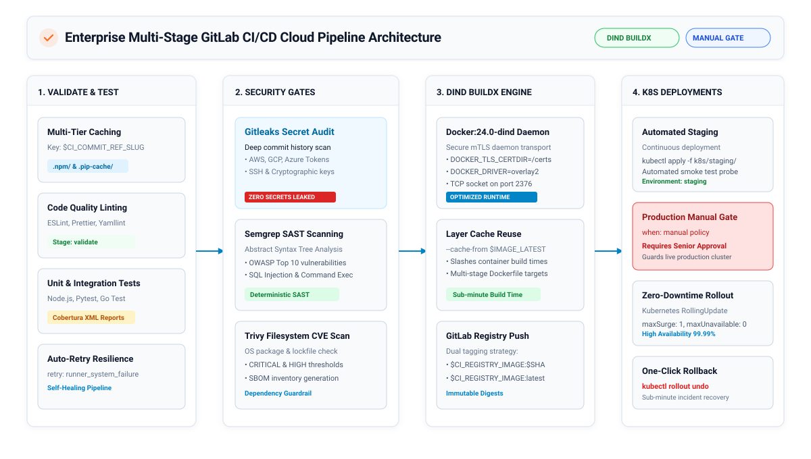

# Enterprise Multi-Stage GitLab CI/CD Cloud Pipeline

[](https://github.com/tayyabmasood911/gitlab-ci-multistage-cloud-pipeline/actions)
[](SECURITY.md)
[](LICENSE)
[](https://docs.gitlab.com/ee/ci/)
[](https://kubernetes.io)

A turnkey enterprise-grade GitLab CI/CD pipeline template engineered for multi-tier branch caching, secure Docker-in-Docker (DinD) layer caching, automated DevSecOps security scanning, staging environment delivery, and manual approval-gated production rollouts with instant rollback capabilities.

---

## Architectural Blueprint

The pipeline is partitioned into 6 distinct stages connected by secure TLS networks and distributed branch caches:



---

## Pipeline Stages & Lifecycle

| Stage | Purpose | Primary Image / Service | Security & Quality Controls |
|:---|:---|:---|:---|
| **`validate`** | Static code and YAML style checking | `node:20-alpine`, `python:3.12-alpine` | ESLint, Prettier, Yamllint schema check. |
| **`test`** | Automated unit & integration testing | `node:20-alpine` | Cobertura test coverage report generation. |
| **`security`** | DevSecOps security scans | Gitleaks, Semgrep SAST, Trivy | Zero-tolerance secret leaks, SAST vulnerabilities, CVEs. |
| **`build`** | Optimized container build | `docker:24.0-cli` + `docker:24.0-dind` | Overlay2 storage, mTLS daemon, Docker layer cache. |
| **`deploy-staging`** | Continuous staging deployment | `dtzar/helm-kubectl` | Automated rolling update, staging smoke test probes. |
| **`deploy-production`**| Production release & rollback | `dtzar/helm-kubectl` | **Manual approval gate**, zero-downtime RollingUpdate. |

---

## Docker-in-Docker (DinD) & Caching Mechanics

### High-Performance Daemon Configuration
```yaml
variables:
  DOCKER_HOST: tcp://docker:2376
  DOCKER_TLS_CERTDIR: "/certs"
  DOCKER_TLS_VERIFY: 1
  DOCKER_CERT_PATH: "$DOCKER_TLS_CERTDIR/client"
  DOCKER_DRIVER: overlay2
```

### Multi-Tier Distributed Caching
```yaml
cache:
  key: "$CI_COMMIT_REF_SLUG"
  paths:
    - .npm/
    - .pip-cache/
  policy: pull-push
```

---

## Quick Start & Usage

### 1. Ingesting into Target Repository
Copy `.gitlab-ci.yml` and `k8s/` into your target repository root:

```bash
git clone https://github.com/tayyabmasood911/gitlab-ci-multistage-cloud-pipeline.git
cp gitlab-ci-multistage-cloud-pipeline/.gitlab-ci.yml my-app/
cp -r gitlab-ci-multistage-cloud-pipeline/k8s my-app/
```

### 2. CI/CD Environment Variables
Configure these in **Settings > CI/CD > Variables**:

| Variable | Description | Protected | Masked |
|:---|:---|:---:|:---:|
| `CI_REGISTRY` | GitLab Container Registry endpoint | No | No |
| `CI_REGISTRY_USER` | Registry deployment token username | Yes | No |
| `CI_REGISTRY_PASSWORD` | Registry deployment token secret | Yes | Yes |
| `KUBE_STAGING_URL` | Kubernetes staging API endpoint | Yes | No |

---

## Local Verification & Healthcheck

```bash
# Lint GitLab CI configuration syntax and stage logic
python3 scripts/lint_gitlab_ci.py

# Run unit test suite
python3 -m unittest discover -s tests -p "test_*.py"

# Run healthcheck
bash scripts/healthcheck.sh
```

---

## Security Governance & Disclosure

For security inquiries or vulnerability reports, consult our [Responsible Disclosure Policy](SECURITY.md) or contact **Tayyab Masood** at [tayyabmasood911@gmail.com](mailto:tayyabmasood911@gmail.com).

---

## License

Licensed under the MIT License. See [LICENSE](LICENSE) for details.
